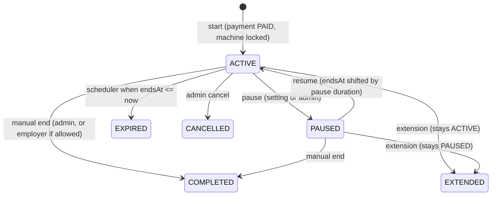

# Business Logic

This document is the authoritative description of how the business rules are implemented. If code and
this document disagree, the tests in `backend/tests` describe the intended behaviour; update both
together.

## 1. Actors and permissions

| Capability | Admin | Employer |
|---|---|---|
| Manage machines, QR codes, categories | ✅ | ❌ |
| Manage packages, prices, durations | ✅ | ❌ |
| Create/suspend employers, reset passwords | ✅ | ❌ |
| View all sessions, payments and expenses | ✅ | ❌ |
| Start, pause, resume, extend, end sessions | ✅ | ✅ (subject to settings) |
| Record cash payments | ✅ (on behalf of an employer) | ✅ |
| Void/refund payments | ✅ | ❌ |
| View own payments/sessions | ✅ | ✅ |
| View other employers' private records | ✅ | ❌ |
| Reports, audit logs, settings | ✅ | ❌ |

Permissions are checked in the backend on every request. UI visibility is only cosmetic.

## 2. Package applicability

A package is sellable for a machine only if **all** are true:

- the package belongs to the same business, is `ACTIVE` and not soft-deleted;
- its scope matches:
  - `ALL` → any machine;
  - `CATEGORY` → the machine's category equals the package category;
  - `MACHINES` → the machine is linked in `PackageMachine`.

The mobile app never receives inactive/out-of-scope packages, and the backend revalidates the package
when creating a payment or extension. A request that supplies a different amount or duration is
ignored because those fields are not accepted from the client.

## 3. QR code lifecycle

1. Registering a machine creates QR version 1 with a random 192-bit secret.
2. The printed payload is `grs:v1:<secret>`.
3. The database stores `HMAC-SHA256(secret, QR_HMAC_SECRET)` for lookup and an AES-256-GCM encrypted
   copy for re-download. The raw secret is never stored in plaintext.
4. Regeneration revokes the current `MachineQRCode` and creates version `n+1`. Old printouts stop
   resolving immediately.
5. Resolution validates: token exists and is active, machine belongs to the same business, machine is
   not soft-deleted, and machine state is `AVAILABLE` with no active session. Otherwise a specific
   `409` error is returned with machine details.
6. If a machine is valid but no active package applies, `409 NO_PACKAGES` is returned.

The QR identifies the machine; it is not the only security boundary. The employer is authenticated and
every operation is authorized server-side.

## 4. Cash payment rules

- Payment is created only after the employer confirms cash was physically received.
- The amount and duration come from the package at that moment and are snapshotted.
- Payment status starts as `PAID` (cash is immediate). `PENDING` exists for future payment methods and
  is not used by the cash flow.
- `idempotencyKey` is generated by the mobile app per payment attempt (UUID v4). Retries with the same
  key return the existing payment; they never create a second charge.
- A payment may be `VOIDED` by an admin when the session never started (cash returned) or automatically
  when a start loses a race and the machine is unavailable. Voiding preserves the record and reason.
- A payment may be `REFUNDED` after a completed/expired session; refunds are audited and excluded from
  revenue.
- Neither action deletes data. Employer accounts can never void, refund or edit a payment.

## 5. Session lifecycle

- `CREATED` is reserved for future pre-created sessions; the cash flow creates `ACTIVE` directly.
- `EXPIRED` means the server timer elapsed. `COMPLETED` means a person ended it.
- Every transition writes a `SessionEvent`. Manual transitions and cancellations are audited.
- A session row keeps its own package name/duration/price snapshots, even if the package changes.
- Extensions increment `durationMinutesSnapshot`/`priceSantim` on the session **and** create separate
  `SessionExtension` and `Payment` rows. Reports show extension revenue separately.

## 6. Timer and countdown rules

1. `startsAt`/`endsAt` are UTC server timestamps.
2. The timer is computed as `endsAt − serverNow`. The mobile app uses either the server-provided
   `remainingSeconds` anchor or the server time offset captured with the response.
3. Wrong device clocks cannot extend a session; the server scheduler is authoritative.
4. If the app is closed, sessions still expire. If the server restarts, the scheduler reconciles all
   overdue sessions at boot.
5. While `PAUSED`, `endsAt` is frozen and the session is not expired. Resume adds the paused duration
   to `endsAt` and `totalPausedSeconds`.
6. Pausing is disabled for employers unless `allowPause` is true. Admin can always pause.
7. When the scheduler expires a session:
   - status becomes `EXPIRED`;
   - `actualEndedAt = endsAt`, `actualDurationSeconds = (endsAt − startedAt)/1000 − pausedSeconds`;
   - the machine becomes `AVAILABLE` only if it is still `IN_USE` (so maintenance status is preserved);
   - admin/employer notifications and socket events are emitted;
   - the audit log records the transition.
8. The scheduler is idempotent: it re-checks status under a row lock and running it twice never creates a
   second expiration event.

## 7. Start race handling

The start operation locks rows in a consistent order: **payment → machine**. Two employers starting the
same machine serialise on the machine row:

1. first transaction checks `AVAILABLE`, creates the session, sets `IN_USE`;
2. second transaction sees `IN_USE`, voids its own unused payment, and returns
   `409 MACHINE_NOT_AVAILABLE` with `paymentVoided: true`.

The employer must refund the customer physically and choose another machine. The admin sees the voided
payment in the transactions screen. A partial unique index (`one active session per machine`) prevents
future code paths from violating the invariant.

## 8. Idempotent retries and network failures

- Payment creation: unique idempotency key per business.
- Session start: unique `paymentId`; retrying returns the existing session.
- Extension: unique idempotency key and unique extension payment id.
- Mobile clients use the same idempotency key for automatic retries of the same attempt.
- If the network fails after the server committed, the retry resolves to the existing record rather than
  double-charging.
- If a start fails because the machine became busy, the payment is voided rather than left `PAID`
  without a session.

## 9. Extensions

- Employer must have `allowExtension` enabled (admin always allowed).
- The extension package must be active and applicable to the machine.
- Cash is collected before confirming; an `EXTENSION` payment is created with a new reference.
- `endsAt` increases by the package duration from the current `endsAt`; a paused session stays paused
  with the longer remaining time.
- Original payment is untouched. The extension is separately visible in the session, transaction list,
  reports and audit log.

## 10. Early end and cancellation

- Employer early end requires `allowManualEnd`. If `requireEndReason` is on, a reason is mandatory.
- Admin can end any session; the admin may also cancel a session (status `CANCELLED`), for example a
  mis-created session. Cancellation does not delete the payment; admins can refund separately.
- Ending releases the machine only after the transaction commits.
- The original payment and its amount are never modified by ending.

## 11. Revenue, refunds and profit

Definitions implemented in reports and dashboard:

- **Revenue** = sum of `Payment.amountSantim` where `status = PAID` and `paidAt` is in the reporting
  range. Both rental and extension payments count.
- **Refunds** = sum of payments whose `refundedAt` is in range and `status = REFUNDED` (shown separately).
  A refunded payment is no longer `PAID`, so it does not remain in revenue.
- **Expenses** = sum of non-deleted expenses whose `expenseDate` is in range.
- **Net profit** = revenue − expenses. Revenue is never called profit.
- **Cash collected today** = paid payments recorded by that employer today in the business timezone.
- Reports group by the business timezone (`Africa/Addis_Ababa` by default); storage remains UTC.
- Money is summed as integers to avoid floating-point errors.

## 12. Admin-configurable rules

| Setting | Effect |
|---|---|
| `allowExtension` | Shows/hides employer extension; server rejects if disabled |
| `allowPause` | Enables employer pause/resume |
| `allowManualEnd` | Enables employer early ending |
| `requireEndReason` | Requires a reason for early end (employer and admin) |
| `expiryWarningMinutes` | Local/DB warning threshold before expiry |
| `lowCashThresholdSantim` | Reserved for admin cash alerts |
| Business timezone | Report grouping and display |
| Currency | Fixed to `ETB` for this deployment |

Changes are audited and take effect immediately for subsequent operations.

## 13. Edge cases

| Case | Behaviour |
|---|---|
| Invalid QR | `404 QR_NOT_RECOGNIZED`; no machine data leaked |
| Machine not found / soft-deleted | QR and API return not found |
| Machine inactive/maintenance | QR resolution and payment reject with clear messages |
| Machine occupied | QR resolution `409`; payment `409`; race start voids payment |
| No packages | QR resolution `409 NO_PACKAGES` |
| Duplicate payment request | Same idempotency key returns original payment |
| Duplicate start | Same payment returns original session |
| Internet loss during countdown | Local countdown continues from server anchor; polling resumes; local notifications still fire |
| App restart | Auth restores with refresh token; active sessions reload from server/cache |
| Backend restart | Scheduler expires overdue sessions at startup; clients re-sync |
| Expired access token | Automatic refresh; failure returns user to login |
| Suspended employer | Login blocked; existing access tokens rejected by DB check; refresh tokens revoked |
| Wrong phone clock | Server timestamps/anchored remaining time remain authoritative |
| Price changed mid-session | Historical snapshots unchanged; future sales use new price |
| Two employers scan same machine | One wins the machine lock; the other receives a conflict and a voided payment |
| Session expiry notification fails | Session still expires in DB; notifications are best-effort |
| Refund after active session | Rejected until the session is ended |
| Void after session started | Rejected |
| Deleting a used package | Rejected; deactivate instead |
| Deleting a machine with active session | Rejected |

## 14. Daily operating procedure (recommended)

1. Admin checks the dashboard and machine availability before opening.
2. Employer signs in; the app restores any active sessions automatically.
3. Customer chooses a machine, pays cash; employer scans QR, selects the package, confirms cash, starts.
4. Employer hands over the machine; the countdown remains visible in the app.
5. When the timer ends the server releases the machine; the employer can start the next rental.
6. At closing, the admin reviews today's cash, sessions, expenses and any anomalies in audit logs.
