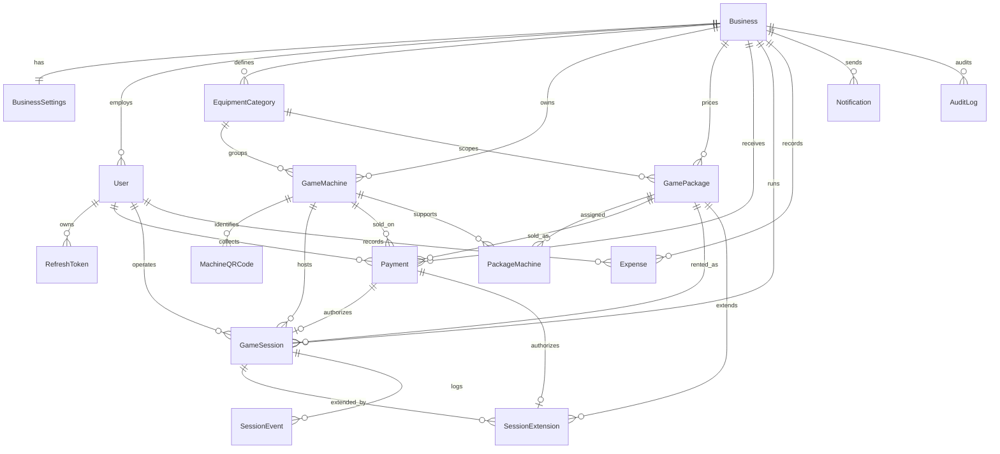

# Database Design

PostgreSQL 15+ is used through Prisma 6. All identifiers are UUIDs unless noted. Money is stored as
**integer santim** (`1 ETB = 100 santim`). All timestamps are UTC.

## 1. Entity relationship overview



## 2. Enums

| Enum | Values |
|---|---|
| `Role` | `ADMIN`, `EMPLOYER` |
| `UserStatus` | `ACTIVE`, `SUSPENDED` |
| `MachineStatus` | `AVAILABLE`, `IN_USE`, `MAINTENANCE`, `INACTIVE` |
| `PackageStatus` | `ACTIVE`, `INACTIVE` |
| `PackageScope` | `ALL`, `CATEGORY`, `MACHINES` |
| `PaymentMethod` | `CASH` |
| `PaymentStatus` | `PENDING`, `PAID`, `REFUNDED`, `VOIDED` |
| `PaymentType` | `RENTAL`, `EXTENSION` |
| `SessionStatus` | `CREATED`, `ACTIVE`, `PAUSED`, `COMPLETED`, `CANCELLED`, `EXPIRED` |
| `SessionEventType` | `STARTED`, `PAUSED`, `RESUMED`, `EXTENDED`, `ENDED_MANUAL`, `EXPIRED`, `CANCELLED` |
| `ExpenseCategory` | `ELECTRICITY`, `MAINTENANCE`, `RENT`, `INTERNET`, `EMPLOYEE_COSTS`, `OTHER` |
| `NotificationType` | session/payment/machine/employer/system notification types |

## 3. Tables

### Business and settings
- **Business** — name, phone, address, currency (`ETB`), timezone (`Africa/Addis_Ababa` by default).
  The initial deployment is single-tenant; `businessId` is present throughout so multi-branch growth
  does not require a rewrite.
- **BusinessSettings** — one row per business:
  - `allowExtension` — employers may sell paid extensions;
  - `allowPause` — employers may pause/resume (admins can always pause);
  - `allowManualEnd` — employers may end early;
  - `requireEndReason` — a reason is mandatory for employer/admin early end;
  - `expiryWarningMinutes` — mobile/local warning threshold;
  - `lowCashThresholdSantim` — optional alert threshold.

### Users and auth
- **User** — full name, unique lowercase username, optional phone, bcrypt `passwordHash`, role,
  status, `lastLoginAt`, soft delete (`deletedAt`). Unique index on `username`.
  `initialPasswordEncrypted` (AES-256-GCM) and `initialPasswordSetAt` optionally hold a provisioned
  temporary password for admin hand-off; both are cleared on the employer's first login or password
  change.
- **RefreshToken** — `tokenHash` (HMAC-SHA256, unique), `familyId`, expiry, revocation, replacement
  link, IP and user agent. Indexed by user and expiry.

### Equipment
- **EquipmentCategory** — unique `(businessId, name)`, active flag.
- **GameMachine** — name, unique `(businessId, code)`, category, brand/model/serial, location, image,
  status, soft delete. Indexed by status and category.
- **MachineQRCode** — one active code per machine lifecycle:
  - `tokenHash` unique (HMAC-SHA256 of the QR secret),
  - `tokenEncrypted` (AES-256-GCM, used to re-download/print),
  - `tokenHint` (last 6 characters shown in the admin UI),
  - `version`, `isActive`, `createdById`, `revokedAt`.
  Regeneration revokes the old row and increments the version; old codes stop resolving.

### Packages
- **GamePackage** — name, description, `durationMinutes`, `priceSantim`, status, `scope`, optional
  `categoryId`, display order, soft delete. The database enforces positive duration (≤1440) and
  non-negative price.
- **PackageMachine** — composite key `(packageId, machineId)` used only for `scope = MACHINES`.
  Applicability:
  - `ALL`: every machine;
  - `CATEGORY`: machines in the package's category;
  - `MACHINES`: explicitly linked machines.

### Payments
- **Payment** — the financial record:
  - unique `transactionRef` and unique `(businessId, idempotencyKey)`;
  - `type` (`RENTAL` / `EXTENSION`), `employerId` (who collected), `createdById` (who recorded);
  - `machineId`, optional `packageId`;
  - snapshot columns: `packageNameSnapshot`, `durationMinutesSnapshot`, `amountSantim`;
  - `method = CASH`, `status`, `paidAt`, `refundedAt`, `voidedAt`, `voidReason`;
  - amount must be positive (check constraint).
  Payments are never deleted. `VOIDED` payments were never usable; `REFUNDED` payments are excluded
  from recognised revenue.

### Sessions
- **GameSession** — unique `paymentId`, machine, employer, package snapshot, `status`, `startedAt`,
  `endsAt`, `pausedAt`, `totalPausedSeconds`, `actualEndedAt`, `actualDurationSeconds`,
  `endedById`, `endedByRole`, `endReason`.
  - Check: `endsAt > startedAt` when both exist.
  - Indexes: `(machineId, status)`, `(employerId, status)`, `(businessId, status)`, `endsAt`.
  - **Partial unique index**:
    ```sql
    CREATE UNIQUE INDEX "GameSession_one_active_per_machine"
      ON "GameSession" ("machineId")
      WHERE status IN ('CREATED', 'ACTIVE', 'PAUSED');
    ```
- **SessionExtension** — unique `paymentId`, package snapshot, duration, price, `previousEndsAt`,
  `newEndsAt`, creator. Check `newEndsAt > previousEndsAt`.
- **SessionEvent** — immutable timeline (`STARTED`, `PAUSED`, `RESUMED`, `EXTENDED`,
  `ENDED_MANUAL`, `EXPIRED`, `CANCELLED`) with optional actor and JSON metadata.

### Finance, audit and notifications
- **Expense** — title, category, positive `amountSantim`, description, `expenseDate`, recorded by,
  optional receipt URL, soft delete.
- **AuditLog** — actor, role, action, entity type/id, `before`/`after` JSON, IP, user agent, timestamp.
  Indexed by business/time and entity.
- **Notification** — target user or admin audience, type, title, body, JSON data, read timestamp.

## 4. Data integrity rules

1. **Money** is integer santim. Aggregation is done with integers or safe numeric casts; no floating
   point storage.
2. **Snapshots** protect history: editing a package never changes existing payment/session values.
3. **Delete behavior**:
   - machines, packages and expenses use soft deletes where history must survive;
   - payments, sessions, extensions and audit logs have no delete path;
   - foreign keys use `Restrict` for financial links and `SetNull` only for optional references.
4. **Idempotency**: `(businessId, idempotencyKey)` on Payment prevents duplicate mobile submissions.
5. **Active-session invariant** is enforced in the database, not only in code.
6. **Timezones**: UTC columns; report grouping uses the business timezone via application-side
   timezone-aware bucketing with `Intl`/`timezone`.

## 5. Migrations

```powershell
cd backend
npx prisma migrate dev --name <change>     # development
npx prisma migrate deploy                  # production / CI
npx prisma generate                        # after schema changes
```

The repository contains:

1. `init` — full schema.
2. `session_guard` — the partial unique index and financial check constraints.

Never edit an applied migration in production. Add a new migration instead.

## 6. Backup and restore

Backup (custom format, compressed):

```powershell
& "C:\Program Files\PostgreSQL\18\bin\pg_dump.exe" -U postgres -Fc -d game_rental -f "backup-game-rental.dump"
```

Restore into an empty database:

```powershell
& "C:\Program Files\PostgreSQL\18\bin\createdb.exe" -U postgres game_rental_restore
& "C:\Program Files\PostgreSQL\18\bin\pg_restore.exe" -U postgres -d game_rental_restore --clean --if-exists "backup-game-rental.dump"
```

Recommended production policy:

- nightly `pg_dump` at low traffic, retained 30 days off-server;
- weekly full backup retained 12 weeks;
- test a restore monthly;
- back up the QR encryption secret and JWT secrets with the database: **without
  `QR_HMAC_SECRET`, existing printed QR codes cannot be re-generated**, and without the JWT secrets all
  sessions are invalidated.
