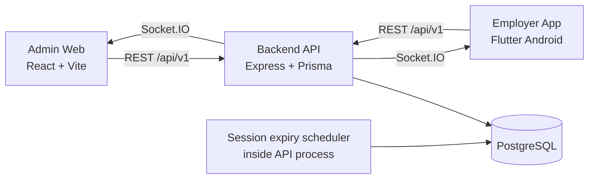

# Project Architecture

## 1. Overview

The Game Rental Management System is a three-tier application with one source of truth:



- **Backend** owns authentication, authorization, pricing, payments, session timers, reports and audit
  logging. It is the only component allowed to mutate business data.
- **Admin Web** is a management client. It never calculates authoritative financial values; it sends
  commands and renders server responses.
- **Employer Mobile** is an operational client. It cannot change prices, durations, machines or other
  employers' records.
- **PostgreSQL** stores all data. Money is stored as integer santim; timestamps are UTC.
- **Socket.IO** pushes operational events to connected admin/employer clients. REST remains the
  fallback so the system works when sockets are unavailable.

## 2. Repository layout

```
app/
├── backend/
│   ├── prisma/
│   │   ├── schema.prisma            # 17 normalized models + enums
│   │   ├── migrations/              # SQL migrations, including DB guards
│   │   └── seed.ts                  # idempotent bootstrap admin + sample config
│   ├── src/
│   │   ├── config/                  # env validation, Prisma singleton
│   │   ├── middleware/              # auth, validation, errors, rate limits
│   │   ├── modules/
│   │   │   ├── auth/                # login, refresh rotation, me, password
│   │   │   ├── users/               # employer management
│   │   │   ├── machines/            # equipment + QR lifecycle + monitoring
│   │   │   ├── categories/          # equipment categories
│   │   │   ├── packages/            # pricing + package scope
│   │   │   ├── qr/                  # QR resolution endpoint
│   │   │   ├── payments/            # cash payments, void/refund
│   │   │   ├── sessions/            # start/end/extend/pause/resume
│   │   │   ├── expenses/            # business costs
│   │   │   ├── reports/             # financial + operational reports + exports
│   │   │   ├── dashboard/           # admin dashboard + employer home snapshot
│   │   │   ├── notifications/
│   │   │   ├── audit-logs/
│   │   │   └── settings/
│   │   ├── services/                # session, package, QR, reports, exports, audit
│   │   ├── jobs/                    # session expiry + warning scheduler
│   │   ├── sockets/                 # authenticated Socket.IO server
│   │   ├── utils/                   # money, time/timezone, errors, pagination
│   │   ├── app.ts                   # Express composition
│   │   └── server.ts                # HTTP server, sockets, graceful shutdown
│   └── tests/                       # Vitest + Supertest integration tests
├── admin-web/
│   └── src/
│       ├── components/              # reusable UI (modals, tables, QR, charts)
│       ├── layouts/                 # sidebar + topbar shell
│       ├── pages/                   # all admin screens
│       ├── services/                # typed API clients
│       ├── stores/                  # auth/session store
│       ├── types/                   # shared API types
│       └── lib/                     # axios client, formatters, helpers
├── employer-mobile/
│   └── lib/
│       ├── core/                    # config, theme, network, router, notifications
│       └── features/                # auth, dashboard, scanner, machines, payments,
│                                    # sessions, history, notifications, profile
├── docs/
├── deploy/nginx/                    # HTTPS reverse-proxy example
├── docker-compose.yml
└── README.md
```

The structure follows the required separation of responsibilities while allowing small modules to
share service helpers (for example, sessions use `packageService` and `auditService`).

## 3. Request lifecycle

1. The client sends a JSON request with a bearer access token.
2. `authenticate` verifies the JWT, then **reloads the user from PostgreSQL** to enforce suspensions and
   role changes immediately.
3. `requireRole` rejects requests outside the user's role.
4. Zod validation strips unknown fields and rejects invalid values. Clients cannot inject a price,
   duration, status or employer id into protected operations.
5. The route calls a service. Financial/session operations run inside `prisma.$transaction` and use
   `SELECT ... FOR UPDATE` row locks where concurrency matters.
6. Domain errors are converted to a stable JSON error envelope by the error middleware. Prisma and
   internal errors never leak stack traces or SQL in production.
7. Successful mutations may emit Socket.IO events and write audit records in the same transaction.

## 4. Authentication and sessions

- Login issues a signed access JWT (default 30 minutes) and an opaque, rotating refresh token
  (default 30 days).
- The access token is sent as `Authorization: Bearer <token>`.
- Browsers receive the refresh token in an `httpOnly`, `SameSite=Lax` cookie scoped to
  `/api/v1/auth`. Mobile clients request it in the JSON body using `x-client-type: mobile` and store it
  in Android encrypted storage.
- Every refresh rotates the token. Reuse outside a short grace window revokes the entire token family.
- Each user may have several devices; each login creates its own family.
- Suspending an employer revokes all refresh tokens immediately.

## 5. Session timer architecture

The server stores `startedAt` and `endsAt` in UTC. The mobile app never decides when a session ends.

- **Start**: inside a transaction, the payment row is locked, the machine row is locked, availability
  is checked, the session is created with `endsAt = now + duration`, the machine becomes `IN_USE`, and a
  session event is written. A PostgreSQL partial unique index
  (`one active session per machine`) is the final concurrency guard.
- **Countdown**: the app polls the session/dashboard every 5–15 seconds. The countdown widget anchors to
  the server-provided remaining seconds/end timestamp. A wrong device clock cannot extend a session.
- **Expiry**: a scheduler runs every 5 seconds in the API process. It finds `ACTIVE` sessions whose
  `endsAt <= now`, locks each row, marks it `EXPIRED`, records the actual duration, releases the machine
  and notifies clients. It runs on startup, which reconciles sessions that expired while the server was
  down.
- **Pause** (admin-configurable): `endsAt` is frozen while paused; resuming shifts `endsAt` by the paused
  duration and accumulates `totalPausedSeconds`.
- **Extensions** add paid time and are persisted as separate `SessionExtension` and `Payment` rows.
- The employer app schedules local notifications at the warning threshold, at one minute, and at
  expiry. These are convenience notifications only.

## 6. Concurrency and integrity

Critical guarantees and where they are enforced:

| Guarantee | Mechanism |
|---|---|
| One active session per machine | machine row lock + partial unique index |
| No two starts from one payment | payment row lock + unique `GameSession.paymentId` |
| No duplicate cash payment retries | unique `(businessId, idempotencyKey)` |
| No duplicate extensions | unique `(businessId, idempotencyKey)` + unique `SessionExtension.paymentId` |
| Historical prices never change | snapshot columns on `Payment`, `GameSession`, `SessionExtension` |
| Financial records never deleted | no delete endpoints; void/refund are audited status changes |
| Password safety | bcrypt with cost 12 |
| QR cannot be guessed | 192-bit random token, HMAC lookup, encrypted copy for reprinting |

## 7. Real-time events

Socket.IO authenticates the handshake with the same access token and joins:
- `business:{id}` for all users,
- `business:{id}:admins` for admins,
- `user:{id}` for personal notifications.

Events: `session:started`, `session:updated`, `session:ended`, `session:expired`,
`session:warning`, `payment:created`, `payment:updated`, `machine:status`, `machine:updated`,
`employer:activity`, `notification:new`.

Clients treat events as cache-invalidation hints, not as authoritative data. Reconnecting clients
re-fetch REST data.

## 8. Scheduling and deployment topology

- Development: Vite dev server proxies `/api` and `/socket.io` to `localhost:4000`.
- Production (Docker Compose): PostgreSQL + API + Nginx-served dashboard. Nginx proxies `/api` and
  `/socket.io` to the API container. Only port 80/443 is exposed publicly.
- Manual VPS: PM2/systemd runs `node dist/server.js`; Nginx terminates TLS and proxies to port 4000.
- The API is stateless except for its database, so it can be restarted freely. Run **one** API instance
  unless the scheduler is made distributed; multiple schedulers are safe because each expiry is row
  locked and idempotent, but a single instance is simpler.

## 9. Key architectural decisions

1. **No customer accounts.** The domain model only has ADMIN and EMPLOYER users.
2. **Backend-first validation.** Every price, duration and role decision is made server-side.
3. **Snapshotting over joins.** A later package edit must not alter historical revenue.
4. **Integer money in santim.** No floating-point arithmetic anywhere in financial paths.
5. **UTC storage + business timezone presentation.** Reports group by the business timezone.
6. **Refresh-token rotation with a grace window.** Balances theft detection with unstable mobile
   networks and lost responses.
7. **Polling plus sockets.** Live data works on poor networks and across app restarts; sockets reduce
   latency when available.
